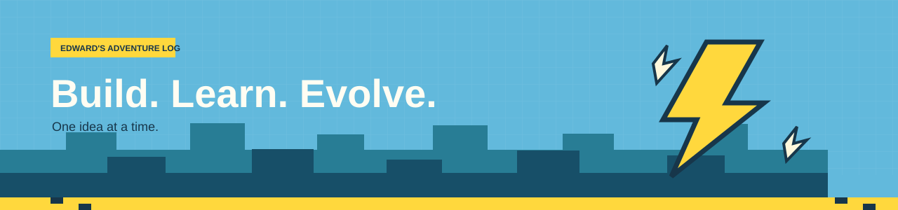

  
   
  
  <h1>Hello, I'm Edward</h1>
  
<strong>Curious mind. Hands-on builder. Always leveling up.</strong>

  
Welcome to my corner of GitHub: ideas, experiments, and things worth sharing.

  <a href="#about">About</a> ·
  <a href="#quest-board">Quest board</a> ·
  <a href="#field-notes">Field notes</a>

---

<h2 id="about">⚡ About</h2>

I'm Edward (Edward-727). I like exploring ideas, learning by building, and sharing the useful parts along the way.

<h2 id="quest-board">🗺️ Quest board</h2>

This is where I'll share projects and experiments as they become ready to explore.

<h2 id="field-notes">📓 Field notes</h2>

New things to learn. New things to make. One quest at a time.

   
  <strong>⚡ Thanks for stopping by. See you on the next quest! ⚡</strong>

